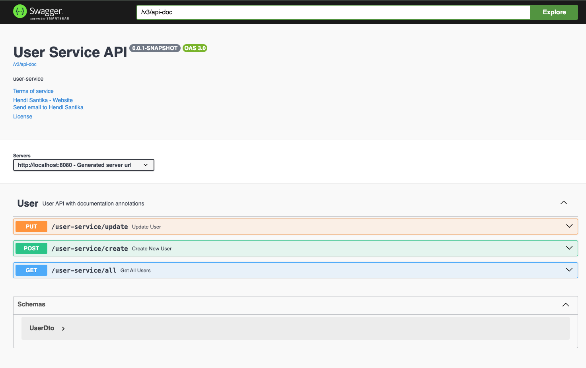
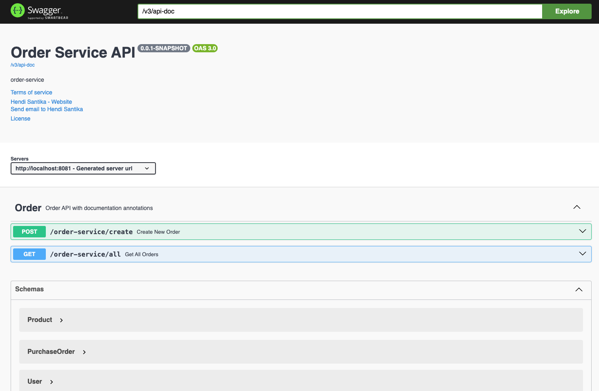

# kafka-event-driven

[](https://github.com/hendisantika/kafka-event-driven/actions/workflows/maven.yml)


Kafka Event Driven microservices using Spring Boot.

## Architecture

```
            ┌──────────────────┐   user-service-event   ┌───────────────────┐
  REST ───▶ │   user-service   │ ─────── (Kafka) ─────▶ │   order-service   │ ◀─── REST
            │   :8080          │                        │   :8081           │
            └────────┬─────────┘                        └─────────┬─────────┘
                     │                                            │
               PostgreSQL (:5433)                          MongoDB (:27017)
```

- **user-service** stores users in PostgreSQL. When a user is updated, it publishes the change to the
  `user-service-event` Kafka topic.
- **order-service** stores purchase orders in MongoDB and consumes `user-service-event` to keep the user data
  embedded in its orders up to date.

## Tech Stack

| Component            | Version / Notes                              |
|----------------------|----------------------------------------------|
| Java                 | **25** (Temurin in CI)                       |
| Spring Boot          | 4.1.x                                        |
| Spring for Kafka     | `spring-boot-starter-kafka`                  |
| Persistence          | Spring Data JPA (PostgreSQL), Spring Data MongoDB |
| API docs             | springdoc-openapi (Swagger UI)               |
| Testing              | JUnit 5 + Testcontainers (PostgreSQL, MongoDB, Kafka) |
| Build                | Maven Wrapper (`./mvnw`)                     |

## Prerequisites

- JDK 25
- Docker & Docker Compose (local infrastructure and Testcontainers)

## Running Locally

1. Clone this repository:
   ```shell
   git clone https://github.com/hendisantika/kafka-event-driven.git
   cd kafka-event-driven
   ```
2. Start the infrastructure (PostgreSQL, pgAdmin, MongoDB, Zookeeper, Kafka):
   ```shell
   docker compose up -d
   ```
3. Run user-service:
   ```shell
   cd user-service
   ./mvnw spring-boot:run
   ```
4. In another terminal, run order-service:
   ```shell
   cd order-service
   ./mvnw spring-boot:run
   ```
5. Open Swagger UI:
    - user-service: http://localhost:8080/swagger-ui
    - order-service: http://localhost:8081/swagger-ui

## API Endpoints

| Service       | Method | Path                     | Description                            |
|---------------|--------|--------------------------|----------------------------------------|
| user-service  | POST   | `/user-service/create`   | Create a user                          |
| user-service  | GET    | `/user-service/all`      | List all users                         |
| user-service  | PUT    | `/user-service/update`   | Update a user & publish a Kafka event  |
| order-service | POST   | `/order-service/create`  | Create a purchase order                |
| order-service | GET    | `/order-service/all`     | List all purchase orders               |

Purchase Order:

```json
{
  "id": "5dcfb1056637311008e17f80",
  "user": {
    "id": 1,
    "firstname": "Itadori",
    "lastname": "Yuji",
    "email": "yuji@yopmail.com"
  },
  "product": {
    "id": 1,
    "description": "iPad"
  },
  "price": 300
}
```

Update User:

```json
{
  "id": 1,
  "firstname": "Satoru",
  "lastname": "Gojo",
  "email": "gojo@yopmail.com"
}
```

## Testing

Integration tests start throwaway PostgreSQL / MongoDB / Kafka containers via
[Testcontainers](https://testcontainers.com/) and Spring Boot `@ServiceConnection`, so no local infrastructure is
needed — only a running Docker daemon.

```shell
cd user-service && ./mvnw verify
cd order-service && ./mvnw verify
```

## CI/CD

GitHub Actions ([`.github/workflows/maven.yml`](.github/workflows/maven.yml)):

- Builds and tests each service in parallel (matrix) on JDK 25.
- Uploads surefire reports when a build fails.
- On push to `main`, submits the Maven dependency graph so Dependabot alerts are accurate.

## Dependency Updates

[Dependabot](.github/dependabot.yml) runs weekly (Monday 05:00 Asia/Jakarta) for:

- **Maven** (`user-service`, `order-service`) — grouped by Spring, springdoc, Testcontainers, Maven plugins and
  minor/patch updates. Spring Boot major upgrades are ignored (manual migration).
- **GitHub Actions** — all actions grouped in a single PR.
- **Docker Compose** images — grouped; PostgreSQL & MongoDB major upgrades are ignored (data migration).

## Image Screenshot

User Service



Order Service


